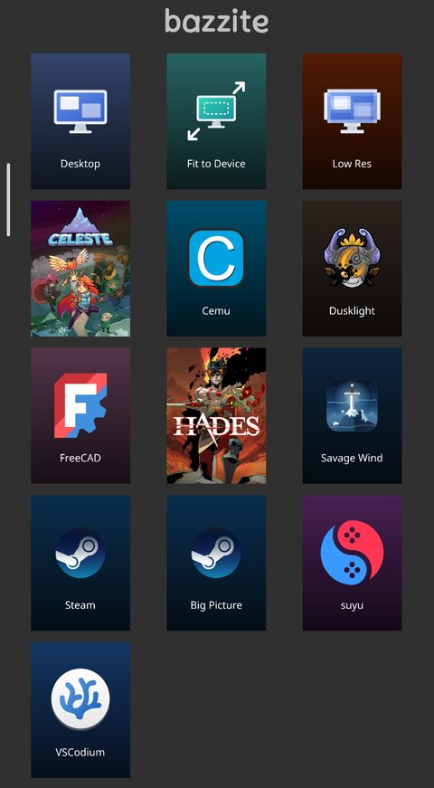

# sunshine-scripts

Helpers for streaming a GNOME (Wayland) desktop with [Sunshine](https://github.com/LizardByte/Sunshine) (Flatpak) to [Moonlight](https://moonlight-stream.org/):

- **`sunshine-res`**: switches the monitor to fit the connecting device while a stream runs, then restores it.
- **`sunshine-add`**: adds an installed app or a Steam game to Sunshine, with a generated cover image.
- **`covers/cover.sh`**: renders 600×800 Moonlight covers in one consistent style.

Built for Sunshine as a **Flatpak** on **GNOME**. Every command reaches the host through `flatpak-spawn --host`.

<p align="center"></p>

## Requirements

| What | Needed by | Check |
|---|---|---|
| Sunshine Flatpak (`dev.lizardbyte.app.Sunshine`) | everything | `flatpak info dev.lizardbyte.app.Sunshine` |
| [`displayconfig-mutter`](https://github.com/eaglesemanation/displayconfig-mutter) on the host | `sunshine-res` | `displayconfig-mutter list` |
| ImageMagick **7** (the `magick` command) and fontconfig | covers | `magick -version` |
| [`gum`](https://github.com/charmbracelet/gum) and Python 3 | `sunshine-add` | `gum --version` |

**Bazzite** already ships `gum`, ImageMagick 7, fontconfig and Python. You only need Sunshine and `displayconfig-mutter`.

### Sunshine (Flatpak)

```sh
flatpak install flathub dev.lizardbyte.app.Sunshine
flatpak run --command=additional-install.sh dev.lizardbyte.app.Sunshine   # input devices + user service
```

On **Bazzite**, use `ujust setup-sunshine enable` instead. It does the same and enables the service.

### displayconfig-mutter

These commands come from the [project's own instructions](https://github.com/eaglesemanation/displayconfig-mutter#installation):

```sh
# Fedora
sudo dnf copr enable eaglesemanation/displayconfig-mutter && sudo dnf install displayconfig-mutter
# Ubuntu / Linux Mint
sudo add-apt-repository ppa:eaglesemanation/displayconfig-mutter && sudo apt update && sudo apt install displayconfig-mutter
# Arch (AUR)
yay -S displayconfig-mutter
```

**Any other distro, including Bazzite, Silverblue and other ostree systems:** download the prebuilt binary to `/usr/local/bin`.

```sh
curl "https://github.com/eaglesemanation/displayconfig-mutter/releases/latest/download/displayconfig-mutter-$(uname -m)" -L -o displayconfig-mutter \
  && sudo install -Dm0755 displayconfig-mutter /usr/local/bin/displayconfig-mutter \
  && rm displayconfig-mutter
```

### ImageMagick 7, gum, fontconfig, Python

```sh
# Fedora
sudo dnf install ImageMagick gum fontconfig python3
# Arch
sudo pacman -S imagemagick gum fontconfig python
```

**Debian/Ubuntu:**
- Older releases still ship ImageMagick 6, which has no `magick` command. Check with `magick -version`.
- `gum` isn't in the default repos. See [gum's install options](https://github.com/charmbracelet/gum#installation).

[Homebrew](https://brew.sh) works on any distro: `brew install imagemagick gum`.

## Install

```sh
git clone https://github.com/inxomnyaa/sunshine-scripts.git && cd sunshine-scripts
./install.sh
```

The script copies `bin/*` to `~/.local/bin` and `covers/*` to `~/.local/share/sunshine-covers`. It never overwrites files that already exist.

## sunshine-res

```sh
sunshine-res apply [W H FPS]   # fit the monitor to the client (defaults to SUNSHINE_CLIENT_* env)
sunshine-res fixed WxH [SCALE] # fixed mode, e.g. 1280x720 100
sunshine-res restore           # back to your normal settings
```

- **`apply`** picks the monitor mode closest to the client's aspect ratio. It then sets the UI scale so the desktop is about 720 logical pixels tall, which keeps text readable on a phone.
- **`fixed`** uses the highest refresh rate available for that mode.

The monitor connector is detected automatically.

**No setup needed for your monitor:** before switching, `apply` and `fixed` save the monitor's current resolution, refresh rate and scale to `$XDG_RUNTIME_DIR/sunshine-res.native`. `restore` puts exactly that back and deletes the file. Only the first switch saves, so if Sunshine crashes between streams, the temporary mode never becomes your "normal" one.

Optional environment variables:

| Variable | Default | Meaning |
|---|---|---|
| `SUNSHINE_RES_NATIVE_MODE` | – | always restore this resolution, e.g. `2560x1440` |
| `SUNSHINE_RES_NATIVE_HZ` | – | …this refresh rate, e.g. `144` |
| `SUNSHINE_RES_NATIVE_SCALE` | – | …this UI scale in %, e.g. `100` |
| `SUNSHINE_RES_TARGET_HEIGHT` | `720` | logical height `apply` aims for |

The three `NATIVE` variables only take effect when all three are set. They then replace the saved settings.

> [!IMPORTANT]
> The settings are saved the moment a stream starts, so the monitor must be in its normal mode at that point. **Stop Sunshine first** (or end every stream) when you set this up or change your normal display settings, and make sure the monitor shows its usual resolution and scale. If a crash ever leaves the monitor stuck in a stream mode, run `sunshine-res restore`.

**Why it waits after each switch:** mutter applies display modes asynchronously, and a refresh-rate change makes the monitor re-sync. If Sunshine starts capturing in the middle of a switch, the XDG portal stream never starts. Moonlight then shows *"no video received"*, Sunshine hangs, and GNOME asks for screen-share permission again. So `sunshine-res` waits until mutter reports the new mode, then gives the monitor 3 seconds to settle.

Add it to an app's `prep-cmd` in Sunshine's `apps.json` (see [`examples/apps.json`](examples/apps.json)):

```json
"prep-cmd": [{
  "do": "sh -c \"flatpak-spawn --host /home/YOU/.local/bin/sunshine-res apply ${SUNSHINE_CLIENT_WIDTH} ${SUNSHINE_CLIENT_HEIGHT} ${SUNSHINE_CLIENT_FPS}\"",
  "undo": "flatpak-spawn --host /home/YOU/.local/bin/sunshine-res restore"
}]
```

`flatpak-spawn --host` doesn't forward Sunshine's environment variables. That's why the client size is passed as arguments.

## sunshine-add

```sh
sunshine-add                         # interactive: "Installed app" or "Steam game"
sunshine-add steam <appid>           # add a Steam game with defaults
sunshine-add desktop <file.desktop>  # add a .desktop app with defaults
```

1. You choose an app from your `.desktop` entries (user, Flatpak and system) or a game from your Steam library. Both lists are searchable.
2. You set the name and decide whether the stream should fit the monitor to the client.
3. For installed apps, you decide whether the stream ends when the app closes.
4. It creates the cover from one of three sources:
   - **Generated**: the app icon on a gradient tinted with the icon's colour.
   - **Steam box art**: taken from Steam's local library cache.
   - **[SteamGridDB](https://www.steamgriddb.com/)**: the first time, it asks for a free API key and saves it to `~/.config/steamgriddb/api_key`.
5. It writes the entry to Sunshine's `apps.json`. An app with the same name is updated, and a backup is kept as `apps.json.before-add`.
6. It offers to restart Sunshine through its systemd user service.

### Moonlight app order

Moonlight sorts apps alphabetically and has no setting for that. To pin apps to the top, start their names with spaces: `"  Desktop"` sorts before `" Something"`, which sorts before `"Anything"`.

## covers

`cover.sh` provides `cover` (icon + label on a tinted gradient) and `steamcover` (portrait art cropped to 600×800). `sunshine-add` records each generated cover in `make-covers.sh`, so you can re-render all of them later.

## Notes

- **Share-screen dialog keeps coming back:** Sunshine's Flatpak captures the screen through the XDG portal. Each GNOME restore token works only once, so a crash or a force-kill (`flatpak kill`) costs you the saved permission. Set `encoder = nvenc` (or the one encoder that works on your GPU) in `sunshine.conf`, so the startup checks open fewer portal sessions, and stop Sunshine with SIGTERM rather than SIGKILL.
- **Moonlight over Tailscale:**
  - Add the PC in Moonlight by its Tailscale IP.
  - Make sure Moonlight isn't excluded in the Tailscale Android app's split tunneling.
  - Allow `41641/udp` in the PC firewall, so Tailscale can hold a direct connection instead of falling back to a relay.

## Tip: two extra desktop entries

Next to Sunshine's normal **Desktop**, these two are handy. The screenshot above shows them as "Fit to Device" and "Low Res".

| Entry | What it does | `do` | `undo` |
|---|---|---|---|
| **Fit to Device** | fits the monitor to whatever connects: phone, tablet, laptop | `sh -c "flatpak-spawn --host /home/YOU/.local/bin/sunshine-res apply ${SUNSHINE_CLIENT_WIDTH} ${SUNSHINE_CLIENT_HEIGHT} ${SUNSHINE_CLIENT_FPS}"` | `flatpak-spawn --host /home/YOU/.local/bin/sunshine-res restore` |
| **Low Res** | a fixed low resolution for slow connections | `flatpak-spawn --host /home/YOU/.local/bin/sunshine-res fixed 1280x720 100` | `flatpak-spawn --host /home/YOU/.local/bin/sunshine-res restore` |

Replace `/home/YOU` with your home folder. With an ostree system (Silverblue, Bazzite…), use the real path, e.g. `/var/home/YOU`.

**Add them in Sunshine's web UI:**
1. Open `https://localhost:47990` and go to **Applications → Add New**.
2. Enter a name. Start it with spaces to pin it to the top in Moonlight, e.g. `" Low Res Desktop"`.
3. Under **Command Preparations**, add a row with the `do` and `undo` commands from the table above.
4. Leave **Command** empty: the entry just streams the desktop.
5. Optionally set **Image** to a cover (see below), then save.

Or paste the entries from [`examples/apps.json`](examples/apps.json) into Sunshine's `apps.json` (`~/.var/app/dev.lizardbyte.app.Sunshine/config/sunshine/apps.json`) and restart Sunshine.

**Picking the Low Res mode:** `fixed` only accepts modes your monitor supports. List them with:

```sh
displayconfig-mutter list -c <connector>   # connector from: displayconfig-mutter list
```

Take a low mode with your monitor's aspect ratio. At low resolutions GNOME often allows only a few UI scales. At 1280×720 that's just 100% or 125%.

**Matching covers:**

```sh
cd ~/.local/share/sunshine-covers && . ./cover.sh
cover desktop         "Desktop"       desktop.svg
cover desktop-dynamic "Fit to Device" desktop-dynamic.svg
cover desktop-lowres  "Low Res"       desktop-lowres.svg 380 "#c2410c"
```

Then set **Image** to `~/.local/share/sunshine-covers/desktop-dynamic.png` or `desktop-lowres.png`, using the full path.

## License

MIT
