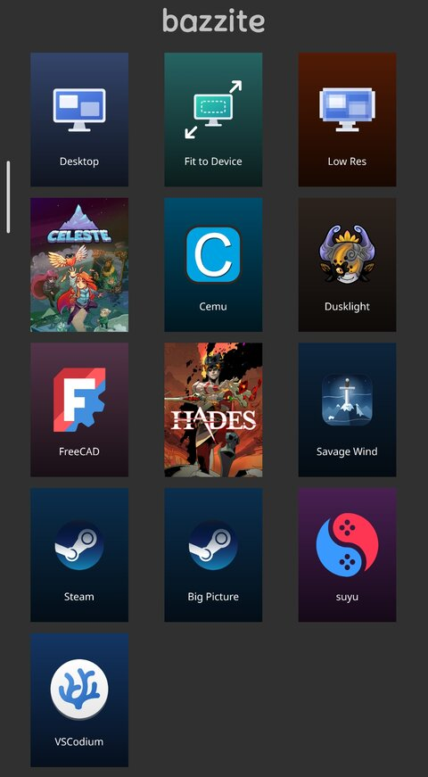

# sunshine-scripts

Helpers for streaming a GNOME (Wayland) desktop with the [Sunshine](https://github.com/LizardByte/Sunshine) Flatpak to [Moonlight](https://moonlight-stream.org/):

- **`sunshine-res`**: fits the monitor to the connecting device during a stream, then restores it.
- **`sunshine-add`**: adds an installed app or Steam game to Sunshine, with a generated cover.
- **`covers/cover.sh`**: renders 600×800 Moonlight covers in one style.

On Android, [Artemis](https://github.com/ClassicOldSong/moonlight-android) is preferred over Moonlight. It pairs with regular Sunshine.

Tested on Bazzite (GNOME, Wayland, NVIDIA).

<p align="center"></p>

## Requirements

- Sunshine Flatpak (`dev.lizardbyte.app.Sunshine`; on Bazzite: `ujust setup-sunshine enable`)
- [`displayconfig-mutter`](https://github.com/eaglesemanation/displayconfig-mutter#installation) on the host
- ImageMagick 7 (`magick`), fontconfig, [`gum`](https://github.com/charmbracelet/gum#installation), Python 3 (all preinstalled on Bazzite)

<details>
<summary>Install the requirements</summary>

```sh
# Sunshine (Flatpak) + input devices and user service
flatpak install flathub dev.lizardbyte.app.Sunshine
flatpak run --command=additional-install.sh dev.lizardbyte.app.Sunshine

# displayconfig-mutter
sudo dnf copr enable eaglesemanation/displayconfig-mutter && sudo dnf install displayconfig-mutter   # Fedora
sudo add-apt-repository ppa:eaglesemanation/displayconfig-mutter && sudo apt install displayconfig-mutter   # Ubuntu / Mint
yay -S displayconfig-mutter   # Arch
# any distro, incl. Bazzite / Silverblue:
curl -L "https://github.com/eaglesemanation/displayconfig-mutter/releases/latest/download/displayconfig-mutter-$(uname -m)" -o displayconfig-mutter \
  && sudo install -Dm0755 displayconfig-mutter /usr/local/bin/displayconfig-mutter && rm displayconfig-mutter

# ImageMagick 7, gum, fontconfig, Python
sudo dnf install ImageMagick gum fontconfig python3   # Fedora
sudo pacman -S imagemagick gum fontconfig python      # Arch
brew install imagemagick gum                          # any distro (older Debian/Ubuntu ship ImageMagick 6)
```

</details>

## Install

```sh
git clone https://github.com/inxomnyaa/sunshine-scripts.git && cd sunshine-scripts && ./install.sh
```

Copies `bin/*` to `~/.local/bin` and `covers/*` to `~/.local/share/sunshine-covers` (never overwrites).

## sunshine-res

```sh
sunshine-res apply [W H FPS]   # closest mode to the client's aspect ratio, UI scaled for readability
sunshine-res fixed WxH [SCALE] # fixed mode, e.g. 1280x720 100
sunshine-res scale [SCALE]     # keep resolution + refresh rate, only enlarge the UI (for games with resolution mods)
sunshine-res restore           # back to the settings saved before the first switch
```

- Your normal mode is saved automatically on the first switch, so **stop Sunshine before setup** to make sure it saves the right one.
- Waits until mutter has applied each mode change; capturing mid-switch breaks the stream.
- Use it as an app's `prep-cmd` (`do`/`undo`) with `flatpak-spawn --host`; see [`examples/apps.json`](examples/apps.json).

## sunshine-add

```sh
sunshine-add                         # interactive: installed app or Steam game
sunshine-add steam <appid>           # Steam game, defaults
sunshine-add desktop <file.desktop>  # .desktop app, defaults
```

Cover from the app icon, Steam box art or [SteamGridDB](https://www.steamgriddb.com/) (API key saved to `~/.config/steamgriddb/api_key`). Backs up `apps.json` before writing.

## Tips

- **Pin tiles to the top:** Moonlight sorts by name, so start names with spaces (`"  Desktop"` before `" Low Res"` before `"Anything"`).
- **Share dialog keeps returning:** set `encoder = nvenc` (or your one working encoder) and stop Sunshine with SIGTERM, not `flatpak kill`.
- **Over Tailscale:** add the PC by its Tailscale IP, don't exclude Moonlight in split tunneling, allow `41641/udp` in the firewall.

## License

MIT
